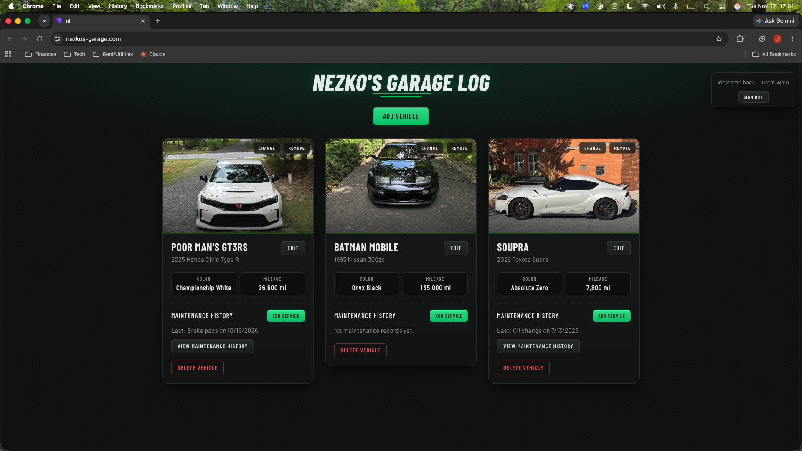

# Nezko's Garage

A personal web app for tracking maintenance on family vehicles.

**Website:** https://nezkos-garage.com



## Features
- Google sign-in with Firebase Authentication
- Vehicle records: name, make, model, year, mileage, color, plus optional trim, VIN, and license plate
- Per-owner access: each vehicle can only be read or changed by the users listed as its owners
- Maintenance history per vehicle (service type, date, mileage, cost, details) with add, edit, and delete
- Wish list per vehicle (item name, link, the price you want to pay)
- Automatic price tracking: a scheduled AWS Lambda checks each wish list link once a day, and the wish list shows a "price drop" notice when the current price is below your price, or a red notice when the site blocks automated checks (HTTP 401, 403 or 429) or the page is gone (404 or 410)

## Tech stack
- **Frontend:** React, TypeScript, Vite, TanStack Query
- **Auth and data:** Firebase Authentication (Google sign-in) and Firestore
- **Hosting:** AWS Amplify Hosting
- **Scheduled job:** AWS Lambda (Node.js) triggered daily by Amazon EventBridge Scheduler, with the Firebase service account stored in AWS Systems Manager Parameter Store (SecureString); logs in CloudWatch
- **DNS and domain:** Amazon Route 53 (domain registration and hosted zone)
- **HTTPS:** Amplify-managed certificate (AWS Certificate Manager)
- **CI/CD:** Amplify builds and deploys automatically on every push to `main`

## Architecture
The browser talks directly to Firebase. There is no backend server of my own, and
access is enforced by Firestore security rules: each vehicle document has an
`owners` list, and only those users can read or change it. These are the rules:
- Require sign-in for every read and write
- Only allow access to vehicles where the user's ID is in the owners list
- Validate required fields, types, and limits (name, make, model, year, mileage) on create and update
- Prevent changing a vehicle's owners after creation

```
Browser (React app on AWS Amplify)
   |-- Google sign-in --> Firebase Authentication
   |-- reads/writes   --> Firestore (checked by security rules)

EventBridge Scheduler (daily)
   |-- invokes --> Lambda "price-checker"
                     |-- reads service account --> SSM Parameter Store
                     |-- reads/writes (Admin SDK, bypasses rules) --> Firestore
                     |-- fetches each wish list link, reads price from the page
```

### Price tracking flow
1. You add a wish list item with a link and the price you want to pay (`price`).
2. Once a day, EventBridge Scheduler invokes the `price-checker` Lambda.
3. The Lambda loads the Firebase service account from Parameter Store, reads every vehicle, and fetches each item's link (10 second timeout). The items of one vehicle are fetched in parallel; vehicles are handled one at a time.
4. It reads the price from the page's JSON-LD (`offers.price`) and saves `currentPrice` and `lastCheckedAt` on the item, or `priceError` if no price could be read.
5. Writes happen in a Firestore transaction that merges by item id, so edits made while the checker was running are not overwritten.
6. The app reads the updated vehicle through TanStack Query. When `currentPrice < price`, the wish list shows a price drop notice with the difference. If the site refused the checker (`priceError` of HTTP 401, 403 or 429), the item shows a red "this website blocks automated price checks" notice instead; for HTTP 404 or 410 it says the page seems to be gone.

The Lambda uses the Firebase Admin SDK, which bypasses Firestore security rules, so its credentials are kept in Parameter Store and never committed to the repo.

## Run locally
```bash
npm install
npm run dev
```

You'll need a Firebase project with Google sign-in and Firestore enabled. The
Firebase web app config is set up in `src/lib/firebase.ts`.

## Tests
```bash
npm test
```
Vitest with jsdom and Testing Library. Tests sit next to the code as `*.test.ts(x)` and cover the Firestore API functions, route guards and routes, the TanStack Query hooks, the wish list card, and the Lambda's price parsing (`functions/price-checker/price.test.mjs`).

## Deployment
Pushes to `main` trigger an Amplify build (`amplify.yml`, managed in amplify). The site started as a
static site on S3 deployed with GitHub Actions, then moved to Amplify for managed
HTTPS, custom domain support, and simpler CI/CD.

The price checker is not deployed by Amplify. It lives in `functions/price-checker/`; to change it, zip `index.mjs`, `package.json` and `node_modules` and upload the zip in the Lambda console.

The custom domain (`nezkos-garage.com`) is registered in Route 53. Amplify
manages the DNS records and certificate in the domain's hosted zone.

## Lessons learned
- Adding a custom domain in Amplify before registering it created a second hosted
  zone that conflicted with the one the Route 53 registrar made. Registering the
  domain first, then letting Amplify write its records into the registrar's zone,
  fixed certificate validation.
- Every new domain a site is served from has to be added to Firebase's authorized
  domains list, or Google sign-in fails.
- The Lambda first read a field named `url`, but wish list items store `link`, so it checked nothing (`checked: 0`). Check real field names in the data before writing code against them.
- JSON-LD price extraction only works on sites that publish structured data; others are recorded as `priceError` instead of failing the whole run.
